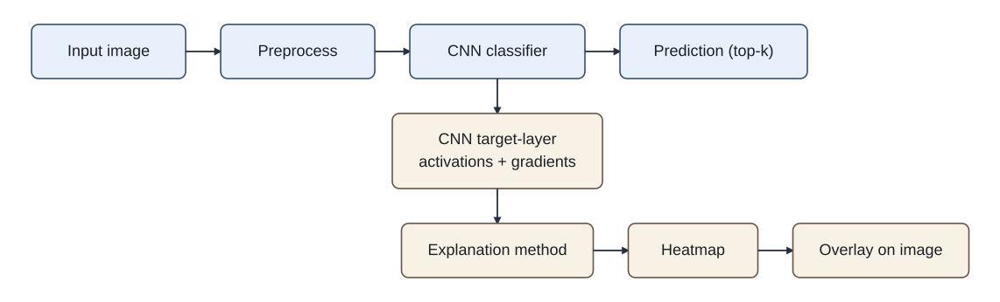

# ExplainVision

**See why an image classifier made its prediction.**


-666666)

ExplainVision is a learning and portfolio project in explainable image classification. You upload a photo, a convolutional network names its top classes, and the app shows where the network was looking. Several explanation methods run on the same image, side by side, so a heatmap is something you can compare.

It is the follow-up to [VisionClassify](https://github.com/cendysaputra/VisionClassify), which classifies CIFAR-10 images with a CNN. It sits beside [AudioScope](https://github.com/cendysaputra/AudioScope) (spectrogram classification with Grad-CAM), [VecScope](https://github.com/cendysaputra/VecScope) (an embedding explorer), and [DetectIt](https://github.com/cendysaputra/DetectIt) (object detection), all under [github.com/cendysaputra](https://github.com/cendysaputra).

This commit is the plan and the pipeline figure. No model has been run here, and the [Results](#results) section will stay free of scores until the rules in [PLAN.md](PLAN.md) are met.

## Overview

A classifier returns a class and a confidence. That pair does not say which pixels mattered. ExplainVision attaches an explanation to the prediction.

- The uploaded image is scored by a CNN.
- The app lists the top-k classes from that model's own label set.
- For a chosen class, it builds a heatmap with more than one method.
- Each heatmap is shown beside the others and overlaid on the image.

The methods planned for the first version are Grad-CAM, Grad-CAM++, Score-CAM, Integrated Gradients, and saliency maps. LIME and SHAP come after those, because they are slower and answer a slightly different question: a local surrogate, or a game-theoretic attribution, rather than a class activation map.

Two model families are in scope. The first is the CIFAR-10 CNN from VisionClassify, so the explanations start on a small model from the same series of projects. The second is an ImageNet-pretrained torchvision network, such as ResNet-50 or EfficientNet, so the same methods can be shown on higher-resolution photographs. The second family is there for the explanation, and this repository does not claim a new ImageNet accuracy.

A model-failure gallery will show heatmaps on images the classifier got wrong. The set comes from an evaluation manifest, so the gallery is a sample of the model's mistakes rather than a hand-picked set of flattering cases.

## How it works



Blue boxes are the classification path. Tan boxes are the explanation path. The same drawing is stored as [docs/pipeline.png](docs/pipeline.png).

1. **Input image.** A file the user uploads, or a test image named by an evaluation manifest.
2. **Preprocess.** Resize and normalize the way that model was trained. The CIFAR-10 CNN and an ImageNet network do not share a recipe. The app shows the tensor the network actually scores.
3. **CNN classifier.** A forward pass through the selected network.
4. **Prediction (top-k).** The top classes and their confidences, from the label set that belongs to the loaded model.
5. **CNN target-layer activations + gradients.** For the class being explained, the explanation reads the spatial activations of a chosen convolutional layer and the gradients of the class score at that layer. Integrated Gradients and saliency attribute the input pixels instead, and they still leave the CNN along this branch. The method decides what it reads.
6. **Explanation method.** Grad-CAM, Grad-CAM++, Score-CAM, Integrated Gradients, saliency, and, later, LIME or SHAP.
7. **Heatmap.** One single-channel map, upsampled to the image.
8. **Overlay on image.** The heatmap drawn on the original image, next to the other methods.

Feature maps, gradients, the target layer, class activation maps, and the comparison between methods are written out in [PLAN.md](PLAN.md#background).

## Features

- Upload an image and run a CNN forward pass.
- Show the top-k predicted classes with confidences.
- Build heatmaps with Grad-CAM, Grad-CAM++, Score-CAM, Integrated Gradients, and saliency maps.
- Add LIME and a SHAP variant once the core methods are in place.
- Overlay each heatmap on the image and compare the methods side by side.
- Switch model: the VisionClassify CIFAR-10 CNN, or an ImageNet-pretrained torchvision model (ResNet-50 and EfficientNet to start).
- Choose the class to explain: the top prediction, another class in the top-k, or the true label when the image comes from a labeled set.
- Choose the target layer, with a documented default for each architecture.
- A model-failure gallery of heatmaps on misclassified images, taken from an `eval/` manifest.
- A Streamlit demo that calls the same preprocessing and explainer code as the evaluation scripts.

## Models and datasets

| Model | Role | Data |
| --- | --- | --- |
| VisionClassify CIFAR-10 CNN | The classifier this project explains first. Small images, ten classes. | [CIFAR-10](https://www.cs.toronto.edu/~kriz/cifar.html) (Krizhevsky, 2009) |
| torchvision ResNet-50 | A residual network with ImageNet weights, for higher-resolution photos. | [ImageNet](https://www.image-net.org) (Russakovsky et al., 2015) |
| torchvision EfficientNet | A second pretrained architecture, so a heatmap is not an artifact of one backbone. | [ImageNet](https://www.image-net.org) |

The CIFAR-10 model is the CNN from VisionClassify, pinned by the commit and the weight file that define it. A later checkpoint in that repository, if it is a different architecture, is a different system and is not loaded in its place. ImageNet weights come from torchvision's published checkpoints. This repository does not redistribute CIFAR-10, ImageNet, or those weight files. Download scripts will place datasets in `data/`, which will be gitignored.

No accuracy is listed above. A figure for any of these checkpoints will be quoted in this file only after a script in `eval/` measures the checkpoint this repository actually loads, and writes a metrics file. How that rule works, including the external accuracy reported for the VisionClassify CNN, is in [PLAN.md](PLAN.md#models-and-datasets).

## Tech stack

| Piece | Choice |
| --- | --- |
| Language | Python 3.10+ |
| Models | [PyTorch](https://pytorch.org/), [torchvision](https://pytorch.org/vision/) |
| Class activation maps | [pytorch-grad-cam](https://github.com/jacobgil/pytorch-grad-cam) (jacobgil): Grad-CAM, Grad-CAM++, Score-CAM |
| Input attributions | [Captum](https://captum.ai/): Integrated Gradients, saliency, and SHAP variants |
| Image handling | [OpenCV](https://opencv.org/) |
| Figures | [matplotlib](https://matplotlib.org/) |
| Demo | [Streamlit](https://streamlit.io/) |

Versions will be pinned when the package skeleton is added. Every evaluation run will record the versions it actually imported.

## Project structure

This is the layout the code will follow. Aside from `docs/`, these directories are not in the repository yet.

```text
ExplainVision/
├── README.md
├── PLAN.md
├── docs/
│   ├── pipeline.svg              # static pipeline figure
│   └── pipeline.png
├── data/                         # CIFAR-10 and local images (gitignored)
├── notebooks/                    # exploration; not a source of README numbers
├── src/explainvision/
│   ├── models/                   # VisionClassify CNN and torchvision wrappers
│   ├── explainers/               # Grad-CAM family, Captum, optional LIME/SHAP
│   ├── metrics/                  # deletion, insertion, sanity check, pointing game
│   └── utils/                    # preprocessing, overlays, I/O
├── eval/                         # scripts that write logs and metrics JSON
├── app/                          # Streamlit demo
├── configs/                      # model, layer, and method settings
└── tests/
```

`src/explainvision/` is the library. `eval/` holds the scripts a person runs. This README may quote a number only when one of those scripts wrote it.

## Getting started

**Status: planned / work in progress.** This commit is documentation only. There is no `pyproject.toml`, no `requirements.txt`, no installable package, and no Streamlit app. The commands below are the interface later commits will add. Running them on this commit will fail, because the files do not exist yet.

```bash
python -m venv .venv
source .venv/bin/activate
pip install -e ".[app,dev]"

streamlit run app/streamlit_app.py
```

When the evaluation harness exists, a run will look like the line below. The script, not a person editing a file, will write the log and the metrics JSON. That entry point is not in the tree yet.

```bash
python eval/run_explanations.py --config configs/cifar10_cnn.yaml --out eval/runs/<run-id>
```

## Results

Results will be reported here after evaluation. This repository has not measured classification accuracy or any explanation score, so none is stated.

Every number that later appears in this file will come from a script in `eval/` that was actually run. The run will save its log and a metrics JSON file, and that file will record the model and the config versions. A number that was not produced that way will not be added. That includes an estimate, a partial run, a score remembered from another project, and a vendor figure presented as a measurement made here.

The evaluation will compute deletion AUC, insertion AUC, the model-parameter randomization sanity check of Adebayo et al. (2018), and runtime per method. A pointing-game localization score is optional, and only where a ground-truth region exists. Definitions, citations, and the rule for a reportable run are in [PLAN.md](PLAN.md#evaluation-plan).

## Roadmap

The work is sequenced in [PLAN.md](PLAN.md#milestones). Checked items there are already in the repository. The rest is ahead.

1. **Skeleton.** Package layout, pinned dependencies, the MIT license file, and a gitignore for data and checkpoints.
2. **Models.** Load the pinned VisionClassify CIFAR-10 CNN and the torchvision ImageNet models, with one preprocessing path per checkpoint.
3. **Explainers.** Grad-CAM, Grad-CAM++, Score-CAM, Integrated Gradients, and saliency behind one heatmap interface. LIME and SHAP after those work.
4. **Evaluation.** Deletion and insertion, the randomization sanity check, runtime, and a failure-gallery manifest.
5. **Streamlit.** Upload, top-k, side-by-side overlays, and the failure gallery, calling the same code as `eval/`.
6. **Write-up.** Fill in Results from the metrics files only.

## Related projects

- [VisionClassify](https://github.com/cendysaputra/VisionClassify) — CNN image classification on CIFAR-10. ExplainVision explains that model.
- [AudioScope](https://github.com/cendysaputra/AudioScope) — environmental sound classification on log-mel spectrograms, with Grad-CAM on the spectrogram.
- [VecScope](https://github.com/cendysaputra/VecScope) — a tokenizer and embedding explorer.
- [DetectIt](https://github.com/cendysaputra/DetectIt) — object detection.

## License

The intended license is the MIT License. A `LICENSE` file is not part of this commit. It will be added with the first code. Datasets and pretrained weights keep their own licenses, and that file will not relicense them.
